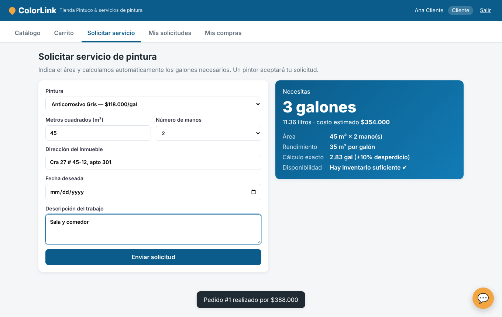

# ColorLink · Tienda Pintuco

Aplicación web para la tienda de pinturas **Pintuco**. Permite:

- Comprar pinturas en línea.
- Calcular cuántos galones se necesitan según los metros cuadrados.
- Contratar un pintor que acepta y gestiona la solicitud.
- Calificar al pintor al terminar el trabajo.
- Conversar con un **chatbot con IA (OpenAI)** en lenguaje natural.

Proyecto final del curso *Taller de aplicación de algoritmos de IA* (Universidad Cooperativa de Colombia).



## Funcionalidades por rol

| Rol | Puede |
|---|---|
| **Cliente** | Ver el catálogo con filtros, usar el carrito y comprar · Calcular galones por m² · Crear solicitudes de servicio · Cancelar solicitudes pendientes · Calificar al pintor (1–5 ★) · Ver su historial |
| **Pintor** | Ver solicitudes disponibles · **Aceptar** · Iniciar · Marcar completado · Ver su calificación promedio y comentarios |
| **Administrador** | Gestionar el inventario (crear, editar, ajustar stock, desactivar) · Ver alertas de stock bajo · Gestionar usuarios · Ver todas las solicitudes · Panel de indicadores |
| **Todos** | Chatbot *PintuBot* con IA: recomienda productos del catálogo real, calcula galones y explica cómo usar la app |

### Flujo de una solicitud de servicio

```
Cliente crea solicitud ──► PENDIENTE ──(pintor acepta)──► ACEPTADA ──► EN PROCESO ──► COMPLETADA ──► Cliente califica ★
                               └──(cliente cancela)──► CANCELADA (la pintura vuelve al inventario)
```

### Fórmula de la calculadora

```
galones = ⌈ (m² × manos ÷ rendimiento m²/galón) × (1 + 10 % de desperdicio) ⌉
```

Ejemplo: 50 m², 2 manos, vinilo que rinde 40 m²/gal → (50 × 2 ÷ 40) × 1,1 = 2,75 → **3 galones**.

## Tecnologías

- **Backend:** Node.js 18+ y Express 5 (API REST con autenticación JWT y bcrypt)
- **Base de datos:** Supabase (PostgreSQL) con el cliente `@supabase/supabase-js`
- **Frontend:** HTML, CSS y JavaScript sin frameworks (carpeta `public/`)
- **IA:** API de OpenAI (`gpt-4o-mini` por defecto). Gemini es opcional como alternativa.
- **Pruebas:** Jest y Supertest (48 casos, 97 % de cobertura de líneas)

## Estructura

```
├── database/
│   ├── schema.sql          # Tablas, restricciones, índices, RLS y vista de ranking
│   └── seed.sql            # Datos de ejemplo (usuarios y pinturas)
├── src/
│   ├── app.js              # Configuración de Express
│   ├── server.js           # Punto de entrada
│   ├── config.js           # Variables de entorno
│   ├── db/                 # Repositorio: supabase.js (real) y memory.js (demo/pruebas)
│   ├── middleware/auth.js  # JWT y control de roles
│   ├── routes/             # auth, pinturas, pedidos, solicitudes, admin, chat
│   └── services/           # calculadora, chatbot (IA), estadísticas
├── public/                 # Interfaz web
├── tests/                  # Pruebas automatizadas
├── scripts/                # Estadísticas, gráficos, evaluación del chatbot, seed
└── docs/                   # Informe de pruebas, resultados estadísticos, capturas, diapositivas
```

## Instalación

### 1. Clonar e instalar

```bash
git clone https://github.com/johangxt/Colorlink-pintuco.git
cd Colorlink-pintuco
npm install
```

### 2. Probar sin base de datos (modo demo)

```bash
npm run demo
```

Abra http://localhost:3000. Los datos viven en memoria y se pierden al reiniciar.

### 3. Configurar Supabase

1. Cree un proyecto en [supabase.com](https://supabase.com).
2. En **SQL Editor**, ejecute `database/schema.sql` y después `database/seed.sql`.
3. En **Project Settings → API**, copie la *Project URL* y la *service_role key*.
4. Copie `.env.example` como `.env` y complete los valores:

```env
DB_PROVIDER=supabase
SUPABASE_URL=https://xxxx.supabase.co
SUPABASE_SERVICE_ROLE_KEY=...
JWT_SECRET=una_cadena_larga_y_aleatoria
AI_PROVIDER=openai
AI_MODEL=gpt-4o-mini
OPENAI_API_KEY=sk-...
```

> La *service_role key* y la clave de OpenAI **solo** van en `.env`, que está en `.gitignore`. Nunca las suba a GitHub.

5. Inicie el servidor con `npm start`.

### Usuarios de prueba

Todos usan la contraseña `Pintuco123*`.

| Rol | Correo |
|---|---|
| Administrador | admin@pintuco.test |
| Pintor | carlos@pintuco.test · laura@pintuco.test |
| Cliente | ana@cliente.test · pedro@cliente.test |

## Comandos

| Comando | Descripción |
|---|---|
| `npm start` | Inicia el servidor |
| `npm run demo` | Inicia el servidor con la base de datos en memoria |
| `npm test` | Ejecuta las pruebas |
| `npm run test:coverage` | Ejecuta las pruebas con cobertura |
| `npm run stats` | Genera las estadísticas (datos reales si `DB_PROVIDER=supabase`, si no, una simulación) |
| `python scripts/graficos.py` | Genera los gráficos del informe (requiere `matplotlib`) |
| `npm run eval:chatbot` | Evalúa el chatbot con la API real de OpenAI |
| `npm run seed:sql` | Regenera `database/seed.sql` |

## API REST (resumen)

| Método | Ruta | Rol |
|---|---|---|
| POST | `/api/auth/registro`, `/api/auth/login` | Público |
| GET | `/api/pinturas` · POST `/api/pinturas/calcular` | Público |
| POST/GET | `/api/pedidos`, `/api/pedidos/mis` | Cliente |
| POST | `/api/solicitudes` · PATCH `/:id/cancelar` · POST `/:id/calificar` | Cliente |
| GET | `/api/solicitudes/disponibles` · PATCH `/:id/aceptar`, `/:id/iniciar`, `/:id/completar` | Pintor |
| GET | `/api/solicitudes/mis` | Cliente / Pintor |
| CRUD | `/api/admin/pinturas`, PATCH `/api/admin/pinturas/:id/stock` | Admin |
| GET | `/api/admin/estadisticas`, `/api/admin/usuarios`, `/api/admin/solicitudes` | Admin |
| POST/GET/DELETE | `/api/chat`, `/api/chat/historial` | Con sesión |

## ¿Cómo se aplica la IA?

El chatbot (`src/services/chatbot.js`) usa un modelo de lenguaje de OpenAI con **contexto aumentado**:

1. **Prompt de sistema con el catálogo en vivo.** En cada mensaje se consultan en la base de datos los productos, precios, rendimiento y stock. Así el modelo solo recomienda lo que existe y marca lo agotado.
2. **Cálculo asistido.** Si el usuario menciona un área (por ejemplo, "45 m2"), el backend calcula los galones con la fórmula oficial y se los pasa al modelo. Esto reduce errores aritméticos de la IA.
3. **Memoria de conversación.** Se envían los últimos 10 mensajes guardados en `mensajes_chat`.
4. **Reglas de comportamiento.** El modelo responde en español, se limita al dominio de pinturas, no inventa productos ni pide datos sensibles.
5. **Evaluación cuantitativa.** `npm run eval:chatbot` mide precisión y latencia con 16 casos de prueba.

## Documentación

- [Informe de pruebas](docs/INFORME_PRUEBAS.md)
- [Resultados estadísticos](docs/RESULTADOS_ESTADISTICOS.md)
- [Capturas de pantalla](docs/img/)
