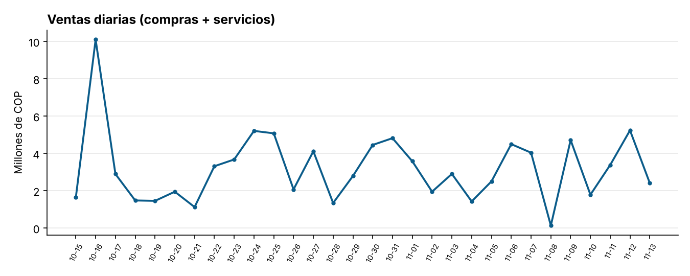
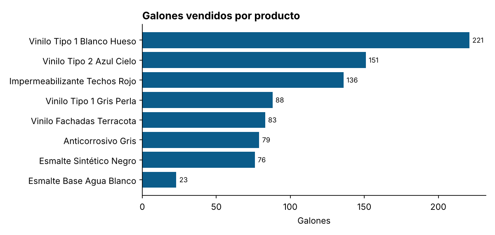
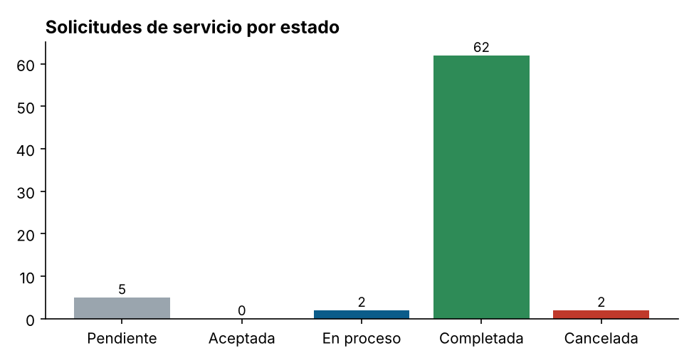
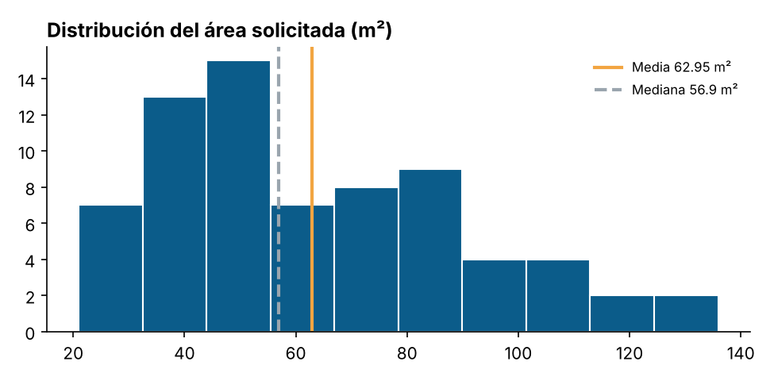
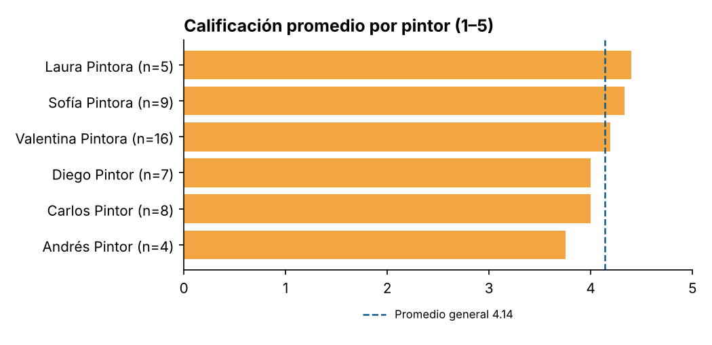
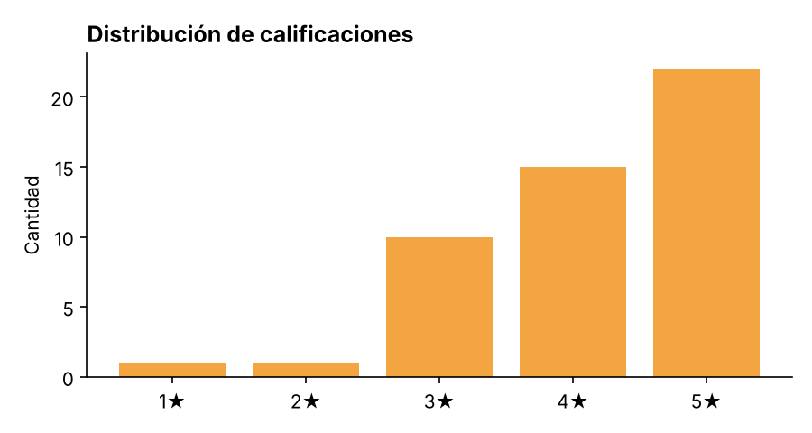

# Resultados estadísticos — ColorLink (tienda Pintuco)

> **Fuente de los datos:** escenario **simulado y reproducible** (semilla 2026) de 30 días de operación (15-oct al 13-nov-2026), con 40 clientes y 6 pintores. Usa las mismas reglas de negocio de la aplicación: calculadora, flujo de estados y calificaciones.
> Para recalcular con datos reales de Supabase: `DB_PROVIDER=supabase npm run stats` y luego `python scripts/graficos.py`.
> Archivos fuente: `docs/estadisticas/resultados.json`, `solicitudes.csv`, `ventas_por_dia.csv`, `ranking_pintores.csv`.

## 1. Indicadores generales

| Indicador | Valor |
|---|---|
| Compras directas (pagadas) | 86 |
| Solicitudes de servicio | 71 |
| Ventas por compras directas | $57.939.000 |
| Ventas de pintura en servicios | $38.036.000 |
| **Ventas totales** | **$95.975.000** |
| Ticket promedio por compra | $673.709 |
| Tasa de solicitudes completadas | 87,3 % |
| Tasa de cancelación | 2,8 % |
| Calificación promedio de pintores | **4,14 / 5** (σ = 0,96; n = 49) |

## 2. Ventas en el tiempo

El promedio diario de ventas es de $3.400.250 los fines de semana y de $3.126.045 entre semana, es decir, **+8,8 %** en fin de semana. La variación entre días es alta, así que el inventario debe planificarse con margen.

## 3. Productos más vendidos

| Producto | Galones | Ingresos |
|---|---|---|
| Vinilo Tipo 1 Blanco Hueso | 221 | $21.658.000 |
| Vinilo Tipo 2 Azul Cielo | 151 | $9.362.000 |
| Impermeabilizante Techos Rojo | 136 | $21.488.000 |
| Vinilo Tipo 1 Gris Perla | 88 | $8.976.000 |
| Vinilo Fachadas Terracota | 83 | $11.205.000 |
| Anticorrosivo Gris | 79 | $9.322.000 |
| Esmalte Sintético Negro | 76 | $11.020.000 |
| Esmalte Base Agua Blanco | 23 | $2.944.000 |

El impermeabilizante es el tercero en galones pero casi iguala en ingresos al líder. Tiene un precio mayor y un rendimiento bajo (12 m²/gal), así que cada servicio de techo consume muchos galones.

## 4. Solicitudes de servicio

| Medida del área solicitada | Valor |
|---|---|
| Media | 62,95 m² |
| Mediana | 56,9 m² |
| Desviación estándar | 27,43 m² |
| Mínimo / máximo | 21 m² / 135,9 m² |

La media es mayor que la mediana, así que la distribución tiene **sesgo a la derecha**: la mayoría pide áreas de 30 a 70 m² (habitaciones y salas) y unas pocas pide áreas grandes (fachadas).

**Tiempo hasta que un pintor acepta:** media de 8,75 h y mediana de 6,5 h (64 solicitudes aceptadas).

## 5. Calidad del servicio (calificaciones)

| Estrellas | 1 | 2 | 3 | 4 | 5 |
|---|---|---|---|---|---|
| Cantidad | 1 | 1 | 10 | 15 | 22 |

El 75,5 % de las calificaciones es de 4 o 5 estrellas. Andrés (3,75) queda por debajo del promedio general. Con muestras de n = 4 a 16 por pintor, las diferencias entre pintores todavía **no son estadísticamente concluyentes**, así que conviene acumular más calificaciones antes de tomar decisiones.

## 6. Precisión de la calculadora de pintura

Para cada solicitud se comparan los galones calculados por el sistema con el consumo teórico exacto (m² × manos ÷ rendimiento):

| Holgura sobre el consumo teórico | Valor |
|---|---|
| Media | +29,0 % |
| Mínimo | +10,3 % |
| Máximo | +85,6 % |

La holgura mínima (10 %) es el margen de desperdicio configurado. El resto se debe a que la pintura se vende **por galón completo**. En áreas pequeñas, redondear hacia arriba pesa más; por ejemplo, 1,1 galones se convierten en 2. Mejora propuesta: ofrecer presentaciones de ¼ de galón.

## 7. Evaluación del chatbot con IA (OpenAI)

El script `npm run eval:chatbot` envía **16 preguntas de prueba** a la API real de OpenAI y mide:

| Categoría | Casos | Criterio de acierto |
|---|---|---|
| Cálculo de galones | 8 | La respuesta contiene el número exacto de galones que da la calculadora |
| Recomendación de productos | 4 | Menciona el producto adecuado del catálogo |
| Uso de la aplicación | 2 | Explica la opción correcta del menú |
| Preguntas fuera de tema | 2 | Redirige al tema de pinturas |

También reporta la **latencia** (media, mediana y p90) y la precisión global. Los resultados se guardan en `docs/estadisticas/evaluacion_chatbot.json`.
**Pendiente:** ejecutar con la clave `OPENAI_API_KEY` del equipo y registrar aquí los valores obtenidos.

| Métrica | Resultado |
|---|---|
| Precisión global | ___ % |
| Precisión en cálculos | ___ % |
| Latencia media | ___ ms |
